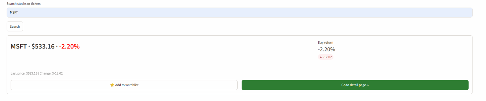
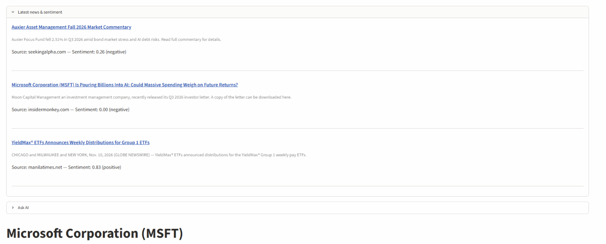
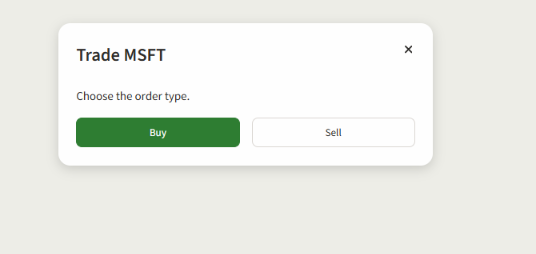
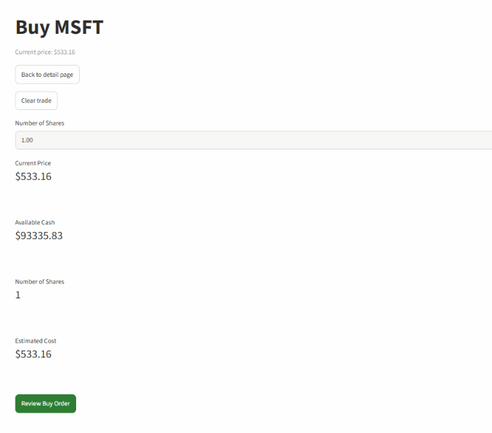
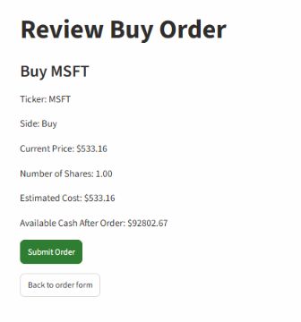
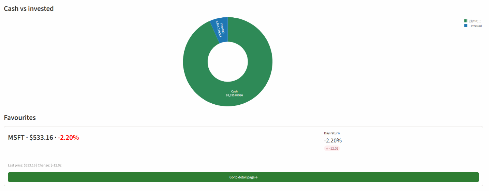
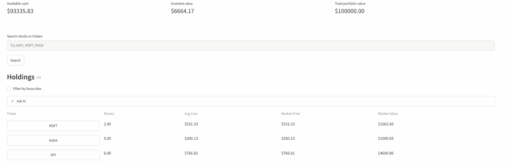
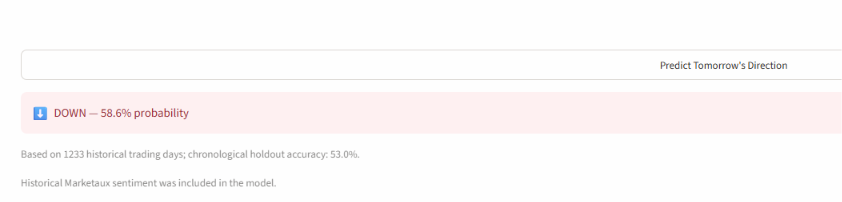
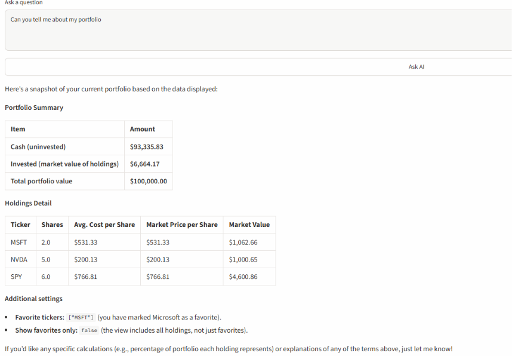
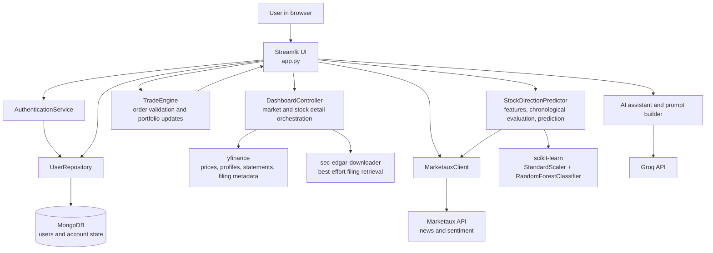

# Paper Trading Simulator & AI Stock Research

This educational Streamlit application lets users research real stock data and simulate investing with virtual cash, without using a brokerage or risking real money. It combines financial data integrations, account and portfolio workflows, an on-demand machine-learning experiment, and a read-only generative-AI assistant.

## Website Link

https://stocktradesim.streamlit.app/

## Key Features

### Stock Research

- Search for a ticker symbol and open its stock detail page.
- View company name, market capitalization, sector, and industry when provided by the market-data source.
- Select a date range and view historical closing prices, daily returns, and a rolling volatility series.



*Search for a ticker and review its price and daily return before opening the stock detail page.*

### SEC and Company Financial Research

- The detail page displays financial-statement data exposed through yfinance's company data interface.
- The application reads filing metadata from yfinance when available. A 10-K retrieval path using `sec-edgar-downloader` is present, but the current downloader initialization does not supply the required company and email arguments, and its errors are suppressed; downloaded filing text is therefore not reliable in the current version.
- The application does not implement a general SEC XBRL financial-facts browser, and its financial-statement tables should not be described as direct SEC XBRL data. Some symbols may show static fallback filing examples rather than current SEC filings.


*Stock detail page with a historical price graph and expandable SEC financial data and recent filing panels.*

### News and Sentiment

- The detail page can show recent ticker-associated news and the sentiment score/label returned or derived from Marketaux article data.
- Historical news can be requested for the direction model when a Marketaux API key is configured.
- The news panel is optional and depends on API access and returned coverage.



*Recent company-related financial news with ticker-specific sentiment information.*

### Paper Trading

- Simulate buy and sell orders using a user's virtual cash balance.
- Choose a share quantity and review the estimated cost or proceeds before submitting.
- Validate the buy against available virtual cash and a sell against shares owned.
- Persist successful trades, updated cash, and updated holdings with the account.
- No brokerage is connected and no real money or securities are involved.

#### Paper Trading Flow

1. **Start Trade** — The Trade action allows users to choose between simulated Buy and Sell orders.

   

2. **Enter Buy Order** — Users select the number of shares while viewing the estimated order cost and available virtual cash.

   

3. **Review Order** — Orders are reviewed before execution so users can verify the ticker, quantity, estimated price, and total simulated cost.

   

### Portfolio

- Store holdings with share quantities and average purchase prices.
- Display virtual cash, holdings, favorites, and a cash-versus-invested chart.
- Add stocks to a persistent favorites list.
- Trade records are stored with the account, but the current UI does not provide a transaction-history screen.
- The portfolio's displayed invested value is based on average purchase cost. It is not a live mark-to-market valuation and does not calculate unrealized profit or loss.



*The favorites view shows a saved ticker with its latest price, daily return, and a link to its detail page.*



*Holdings show ticker, share count, average cost, market price, and market value, alongside available cash and portfolio summary amounts.*

### Machine Learning

- Run a Random Forest classifier on demand from the stock detail page using **Predict Tomorrow's Direction**.
- Uses up to approximately five years of daily market data and, when available, historical Marketaux sentiment.
- Displays an `UP` or `DOWN` classification, its model probability, and chronological holdout accuracy.
- Uses a five-minute Streamlit cache to avoid repeating the same fetch and training work immediately.
- This is an experimental classification feature, not a financial forecast or investment recommendation.



*On-demand Random Forest classification of the next trading-day direction, with model probability and chronological holdout accuracy; predictions are uncertain and are not financial advice.*

### AI Assistant

- A Groq-powered assistant answers read-only questions about the selected stock or portfolio context.
- The prompt is built from data already available to the application, such as company information, current price and daily change, filings, SEC/company statement data, recent news, and portfolio information.
- The assistant is restricted from placing trades, giving trade recommendations, or making price predictions.



*Read-only AI response using portfolio context, including cash, invested amount, holdings, and favorites.*

## Technology Stack

| Technology | Use in this project |
|---|---|
| Python | Application and domain logic |
| Streamlit | Web UI, session state, and short-lived data caching |
| MongoDB / PyMongo | User accounts, virtual cash, holdings, favorites, and stored trade records |
| Pandas | Market-data and financial-data tables and feature preparation |
| NumPy | Numeric feature and target calculations |
| scikit-learn | Feature scaling and Random Forest classification |
| yfinance | Historical market prices, company profile/statement data, and filing metadata |
| `sec-edgar-downloader` | Best-effort SEC filing retrieval, including 10-K text |
| Marketaux | Recent and historical stock-related news and sentiment |
| Requests | Marketaux HTTP requests |
| Groq | Read-only generative-AI responses |
| Plotly | Interactive price, return, volatility, and portfolio charts |

## System Architecture



The Streamlit entry point, `app.py`, coordinates user interaction and session state. `DashboardController` handles market and stock-detail data access; `AuthenticationService` and `UserRepository` separate account validation from MongoDB persistence. `TradeEngine` contains order validation and portfolio arithmetic, while `StockDirectionPredictor` owns feature preparation and model evaluation. The UI persists resulting user state through the repository. External data and AI calls are made through small provider/client modules. This is a modular single application, not a set of independently deployed services.

## Paper Trading Design

The implemented flow is:

```text
Stock Detail
    ↓
Trade
    ↓
Choose Buy or Sell
    ↓
Enter share quantity
    ↓
Review estimated cost or proceeds
    ↓
Validate cash or shares owned
    ↓
Execute simulated order
    ↓
Update virtual cash and holdings
    ↓
Persist trade record with account
```

Buy orders are rejected when the virtual cash balance is insufficient. Sell orders are rejected when the user does not own enough shares. When a buy adds to a position, the application recalculates its weighted average purchase price; a partial sale retains that average cost, and a fully closed position is removed. These controls simulate basic order accounting and do not model broker execution, fees, taxes, or real market fills.

## Machine Learning: Next-Trading-Day Direction

### Goal and target

For each historical trading date, the label is:

```text
UP   when next trading day's Close > current day's Close
DOWN otherwise
```

The detail page uses the selected ticker automatically. The price-history fetch, historical-news fetch, feature construction, training, and prediction run only after the user clicks the prediction button.

### Implemented features

The model currently uses:

- Daily close-to-close return
- 5-, 10-, and 20-session close returns
- 5-, 10-, and 20-session moving averages of closing price
- 5-, 10-, and 20-session rolling standard deviations of daily returns
- Daily volume percentage change
- 5-session average volume
- Daily mean sentiment score and daily news article count

News articles are aligned to the first trading-date close at or after publication. The cutoff is the 4:00 p.m. US Eastern close for each trading date, so news published after a date's cutoff is not assigned to that date. Missing sentiment is forward-filled from prior sentiment and otherwise set to zero; daily article count is zero when no article is aligned to that day. If historical news is missing or unavailable, the model can run using price and volume features only, and the UI reports that fallback.

### Leakage control and chronological evaluation

Features for a row use market observations and sentiment available by that row's close. The next close is used only to create the training label; it is not included as an input feature. The final row, which has no known next-session close, is excluded from labeled training data but can be used as the current prediction row.

The labeled rows are kept in date order. The first 80% train a validation model and the newer final 20% are used as a chronological holdout—there is no random train/test split. `StandardScaler` is inside the scikit-learn pipeline, so it is fit with the training data during holdout evaluation. After calculating holdout accuracy, a fresh pipeline is fit on all labeled observations to produce the current prediction.

### Model and evaluation

The classifier is a scikit-learn `RandomForestClassifier` with 150 trees, a fixed random seed, and balanced-sub-sample class weights. A Random Forest combines decisions from many tree models; the displayed probability is the classifier's probability for its selected class.

The application reports **chronological holdout accuracy** and the number of labeled training observations. It does not currently calculate or display precision, recall, F1, a baseline comparison, or feature importance. No model results are claimed here because accuracy varies with ticker, data coverage, and time period. This experimental model may be wrong and does not guarantee future performance.

## AI Assistant

The assistant follows this request path:

```text
User question
      ↓
Current stock or portfolio context assembled by the app
      ↓
Prompt builder summarizes and prioritizes relevant context
      ↓
Groq chat-completions API
      ↓
Read-only answer in the Streamlit UI
```

On the stock detail page, context can include the selected ticker, company profile, current price and daily change, filing information, financial-statement data, and recent news. On the portfolio page, it can include cash, holdings, favorites, and related summary values. The prompt instructs the model to stay within the page context, acknowledge missing facts, and avoid trade execution, recommendations, and stock price predictions. This is a software-level restriction; it does not make generated answers infallible.

## External Data Sources

- **yfinance** — historical daily market prices and company/profile data; also exposes company statements and filing metadata used by the app.
- **SEC filing retrieval** — `sec-edgar-downloader` is used for best-effort filing downloads, including 10-K text. Filing availability is not guaranteed.
- **Marketaux** — recent ticker-associated financial news and article sentiment; historical news is also requested for on-demand model runs.
- **Groq** — generates responses to the application's read-only AI assistant prompts.

## Installation

### Requirements

- Python with `venv` support
- MongoDB connection string for registration, login, and account persistence
- Optional API keys for Marketaux news/sentiment and Groq AI

```bash
git clone https://github.com/nickh42/econ-project2.git
cd econ-project2

python -m venv .venv
```

Activate the virtual environment:

```bash
# macOS / Linux
source .venv/bin/activate

# Windows PowerShell
.venv\Scripts\Activate.ps1
```

Install dependencies and run the Streamlit entry point:

```bash
pip install -r requirements.txt
streamlit run app.py
```

The test suite can be run with:

```bash
pytest -q
```

## Secrets and Configuration

Create `.streamlit/secrets.toml` locally. Do not commit this file or put real credentials in the README:

```toml
mongodb_uri = "mongodb+srv://<username>:<password>@<cluster>/<database>"
MARKETAUX_API_KEY = "<marketaux-api-key>"
groq_api_key = "<groq-api-key>"
groq_model = "openai/gpt-oss-120b"
```

Only the MongoDB URI is needed for account registration, login, and persistence. Marketaux and Groq features are optional. The application also accepts `GROQ_API_KEY` and `GROQ_MODEL` as alternatives to the lowercase Groq setting names. SEC retrieval is best-effort and does not have a separate application secret in the current code.

## How to Use

1. Add the MongoDB URI to Streamlit secrets, start the app, and register or log in with an email address.
2. Search by ticker symbol and open the result's detail page.
3. Review the selected date range, company information, historical price graph, returns, and volatility.
4. Review available company financial-statement data, filing information, and recent Marketaux news.
5. Select **Trade**, choose **Buy** or **Sell**, enter a quantity, review the estimate, and submit the simulated order.
6. Return to the dashboard to see virtual cash, holdings, and favorites.
7. On a stock detail page, select **Predict Tomorrow's Direction** to fetch history and run the model on demand.
8. Use **Ask AI** on the stock detail or portfolio page to ask a question grounded in the displayed context.

Some data panels may be empty or unavailable when an external provider does not return data or an optional API key is not configured.

## Engineering Concepts Demonstrated

- Python modules and separation of UI, service, repository, and domain responsibilities
- Streamlit forms, reruns, session state, and caching
- MongoDB persistence for accounts and user portfolio state
- Authentication and input validation
- HTTP API integration and handling optional external data
- Financial calculations including returns, rolling volatility, share quantities, and weighted average cost
- Portfolio/order validation and duplicate-order protection within an active app session
- Time-series feature engineering and sentiment-to-trading-date alignment
- Avoiding look-ahead leakage and evaluating with chronological holdout data
- Scikit-learn pipelines, feature scaling, and Random Forest classification
- Context construction and guardrails for a read-only LLM assistant
- Automated tests for calculations, provider behavior, and application logic

For a personal portfolio or application essay, add a short reflection in your own words about the design decisions and challenges you encountered; this README does not assume or invent personal experiences.

## Future Improvements

Possible future work, not currently implemented as complete features:

- Add a transaction-history page and live mark-to-market portfolio valuation/P&L
- Add portfolio benchmarking, alerts, and historical backtesting
- Expand model evaluation with baselines, precision/recall/F1, and feature importance
- Investigate additional market-index features and model comparisons
- Repair SEC 10-K retrieval configuration and add SEC XBRL financial-facts retrieval
- Add model versioning or persistence if repeated model runs become a performance concern

## Limitations and Disclaimer

- Market data may be delayed, incomplete, or unavailable, and external API coverage varies.
- SEC filing retrieval is best-effort; company financial statements exposed by yfinance are not a direct SEC XBRL data feed.
- Sentiment coverage may be sparse, and provider sentiment scores can be inaccurate or noisy.
- Model predictions are uncertain; historical patterns and holdout accuracy do not guarantee future results.
- Groq-generated answers may be incomplete or incorrect despite context and prompt restrictions.
- Paper trading does not reproduce real order routing, execution, liquidity, fees, taxes, or other market behavior.
- Authentication and account handling are educational implementations. Passwords are hashed using unsalted SHA-256, which is not appropriate for production password storage.
- This project is for education and demonstration only. It is not financial advice, an offer to trade, or a recommendation to buy or sell any security.

## Author

- **Student name:** `[Add your name]`
- **GitHub:** `[Add your GitHub profile URL]`
- **Portfolio website:** `[Add your portfolio URL, if available]`
- **Contact:** `[Add contact information, if desired]`
